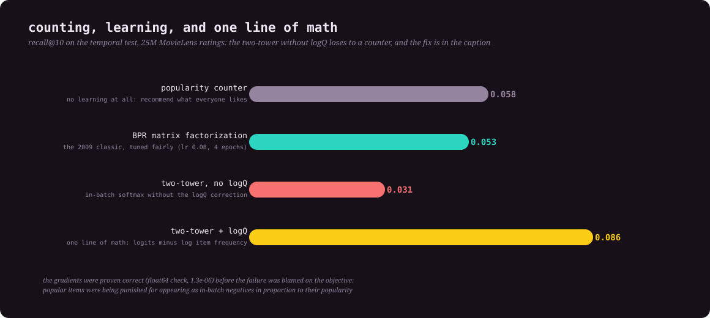
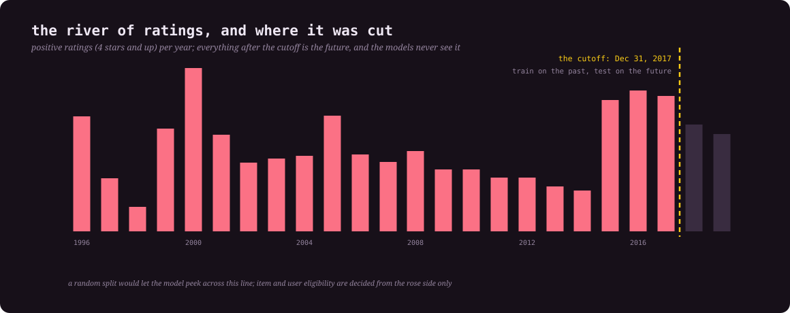
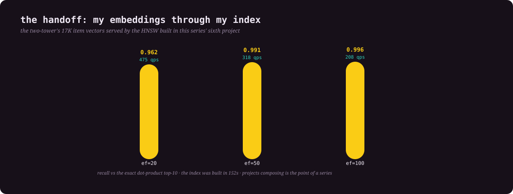

# pulse-recsys

A recommendation system on 25 million real MovieLens ratings, built the way
retrieval teams actually build them: a strict temporal split, a two-tower
retriever trained with in-batch sampled softmax
([Yi et al. 2019](https://research.google/pubs/pub48840/)), honest baselines,
and candidate serving through the HNSW index built earlier in this series.
Also: the best failure of the whole ten-project series, kept on display.



## The failure worth the whole project

My first two-tower scored recall@10 of **0.018, three times worse than a
popularity counter.** Before touching hyperparameters I gradchecked the
hand-written training step in float64: correct to 1.3e-06. The math was
fine; the OBJECTIVE was wrong. In-batch softmax uses the other items in a
batch as negatives, and popular items land in batches in proportion to their
popularity, so training taxes popularity itself, exactly the signal the test
distribution rewards. The fix is the logQ correction: subtract each item's
log sampling probability from its logit.


Same model, one line later: **recall@10 = 0.085**, 46% above the counter and
61% above tuned BPR matrix factorization. (Animation source:
[assets/manim_logq.py](assets/manim_logq.py), video in
[assets/logq.mp4](assets/logq.mp4).)

## The split is the science



Everything before December 31, 2017 is training; everything after is the
future, untouched. Item and user eligibility (5+ interactions) are decided
from the training side only, and items that did not exist before the cutoff
are excluded from test, because no honest system recommends what has not
been made yet. A random split, the tutorial default, would leak sequels,
franchises, and taste drift straight across the line
([pulse/data.py](pulse/data.py), a DuckDB pipeline over the raw 25M rows).

## The ladder, fairly

| model | recall@10 | recall@50 | NDCG@10 |
|---|---|---|---|
| popularity counter | 0.058 | 0.089 | 0.060 |
| BPR-MF (lr 0.08, 4 epochs) | 0.053 | 0.088 | 0.052 |
| two-tower, no logQ | 0.018 | 0.037 | 0.017 |
| **two-tower + logQ** | **0.085** | **0.139** | **0.085** |

Fairness notes that cost real effort: the BPR baseline's first configuration
was undertrained (loss stuck at ln 2), and shipping it would have flattered
the two-tower, so it got retuned before the comparison counted. Seen-item
masking is applied to every model identically. All evaluation is on 6,198
users active after the cutoff, 169,923 held-out interactions.

## The handoff



The two-tower's item embeddings are served through
[hive-index](https://github.com/Kenny0bi/hive-index)'s HNSW, the vector
index built from the paper as project six of this series. The stack
composes: this project's model, that project's index, measured together
([benchmarks/serve_ann.py](benchmarks/serve_ann.py)).

## Machinery notes

- **Per-row Adam** ([pulse/models.py](pulse/models.py)): optimizer state
  updates touch only the embedding rows a batch used; full-table steps at
  148,745 users would be almost entirely wasted work.
- **Gradients by hand, checked by machine**: the softmax-through-L2-norm
  backward is derived in the code and pinned by a float64 finite-difference
  test, the same discipline as the rest of the series.
- **In-batch dedupe**: duplicate items inside a batch would be false
  negatives (a user's positive serving as another row's negative when they
  are the same movie), so batches are deduplicated before the loss.

## Running it

```bash
pip install numpy duckdb
sh data/get_data.sh              # ml-25m; note in the script about their TLS cert
python pulse/data.py             # DuckDB temporal split -> prepared.npz
python benchmarks/train_all.py   # popularity, BPR, two-tower (~30 min)
python benchmarks/serve_ann.py   # serving through hive-index's HNSW
python assets/make_visuals.py
```

## Where this sits

Ninth in the from-scratch ML systems series. The applied capstone of the
modeling side: everything before it built machinery; this one uses that
machinery against 25 million real human decisions, gets humbled by a
counting baseline, and earns the win back with the right objective.
